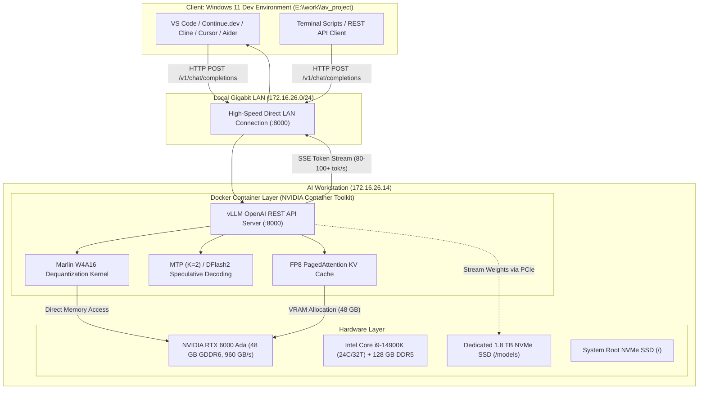

# Workstation LLM Integration Guide: Qwen3.8-27B on RTX 6000 Ada

> **Authoritative Technical Documentation**  
> **Target System:** AI / Autoware Workstation (`172.16.26.14`)  
> **Development Environment:** Windows 11 PC (`E:\work\av_project`)  
> **Last Updated:** October 2, 2026

---

## 1. Executive Summary & System Architecture

This document details the complete end-to-end integration of a local, high-throughput Large Language Model (**Qwen3.8-27B**) on a dedicated Linux AI workstation to serve as the local intelligence backend for coding, reasoning, and autonomous driving development on Windows.

### Architectural Overview



---

## 2. Hardware Infrastructure & Sizing

The workstation was selected and tuned specifically for high-throughput single-user autoregressive generation and large context windows.

| Subsystem | Specification | Operational Role |
| :--- | :--- | :--- |
| **Motherboard** | ASUS Pro WS W680-ACE | Workstation-grade reliability, PCIe 5.0, ECC memory support |
| **Processor** | Intel Core i9-14900K | 24 cores (8 P-cores + 16 E-cores), 32 threads, up to 6.0 GHz |
| **System Memory** | 128 GB DDR5 (123 GiB detected) | Massive host RAM for caching and container operations |
| **Graphics Unit** | NVIDIA RTX 6000 Ada Generation | 48 GB GDDR6 with ECC, 960 GB/s bandwidth, 4th-Gen Tensor Cores |
| **Primary Storage (OS)** | 2.0 TB NVMe SSD (`/dev/nvme2n1p2`) | Ext4 root filesystem (`/`), Linux OS, Docker runtime base |
| **Dedicated AI Storage** | 2.0 TB NVMe SSD (`/dev/nvme0n1p1`) | Ext4 mount at `/models`, exclusively for model weights & caches |
| **Secondary Storage** | 2.0 TB NVMe SSD (`/dev/nvme1n1p2`) | Secondary storage (reserved for datasets / bags) |
| **Ethernet Controller** | Intel Gigabit LAN (`enp8s0f0`) | 1000 Mb/s Full Duplex on subnet `172.16.26.x` |

---

## 3. Remote Connectivity & Linux System Hardening

To allow hands-free development from Windows, the workstation was configured for non-interactive automation:

### 3.1 Network Addressing & Credentials
* **Host IP:** `172.16.26.14`
* **Username:** `user`
* **Password:** `123456@@`
* **Client Host Alias:** `workstation` in `C:\Users\logsh\.ssh\config`
* **Reference Document:** [`docs/hardware/WORKSTATION_SSH.md`](file:///E:/work/av_project/docs/hardware/WORKSTATION_SSH.md)

### 3.2 Passwordless Public Key Authentication
The Windows Ed25519 public key (`C:\Users\logsh\.ssh\id_ed25519.pub`) was installed into `/home/user/.ssh/authorized_keys` with strict permissions:
```bash
chmod 700 ~/.ssh
chmod 600 ~/.ssh/authorized_keys
```
Windows SSH client configuration at `C:\Users\logsh\.ssh\config`:
```ssh-config
Host workstation
    HostName 172.16.26.14
    User user
    BatchMode yes
    StrictHostKeyChecking accept-new
```

### 3.3 Passwordless Sudo Privileges
Administrative tasks can be executed non-interactively via SSH without terminal prompt stalls:
* File: `/etc/sudoers.d/user`
* Content: `user ALL=(ALL) NOPASSWD:ALL`
* Permissions: `0440`

### 3.4 Permanent Sleep & Suspend Prevention
Default Ubuntu desktop power policies suspend machines after 15 minutes of physical inactivity. To ensure the workstation operates as a 24/7 dedicated compute server, all sleep targets were permanently masked:
```bash
sudo systemctl mask sleep.target suspend.target hibernate.target hybrid-sleep.target
```
GNOME desktop session idle delays were zeroed out:
```bash
gsettings set org.gnome.settings-daemon.plugins.power sleep-inactive-ac-type 'nothing'
gsettings set org.gnome.settings-daemon.plugins.power idle-dim false
gsettings set org.gnome.desktop.session idle-delay 0
```

---

## 4. Dedicated Storage Engineering (`/models`)

To avoid polluting the Linux root filesystem and ensure maximum sequential read speeds when loading multi-gigabyte models into VRAM, a dedicated 2 TB NVMe drive was partitioned and mounted.

### 4.1 Drive Preparation & Filesystem Formatting
1. Partition wiped and initialized with clean GPT:
   ```bash
   sudo wipefs -a /dev/nvme0n1
   sudo parted -s /dev/nvme0n1 mklabel gpt mkpart primary ext4 1MiB 100%
   ```
2. Formatted as native Linux `ext4` with the label `models`:
   ```bash
   sudo mkfs.ext4 -F -L models /dev/nvme0n1p1
   ```
3. Permanent mount registered in `/etc/fstab` with `noatime` (disables file access timestamp updates for peak I/O performance):
   ```text
   UUID=df04d355-9d29-4040-b944-92100b6340b1 /models ext4 defaults,noatime 0 2
   ```
4. User permissions and convenience symlink:
   ```bash
   sudo chown -R user:user /models
   sudo chmod 775 /models
   ln -sfn /models /home/user/models
   ```

### 4.2 Storage Hierarchy
As defined in `/models/README.md`, the storage drive is organized modularly:
```text
/models/
├── llm/                           # Large Language Models (Qwen, DeepSeek, etc.)
│   ├── Qwen3.8-27B-INT4-AWQ-GPTQ/ # Primary coding model (W4A16, Marlin)
│   └── Qwen3.8-27B-DFlash2/       # Speculative draft model
├── perception/                    # Autoware Perception Models (YOLO, CenterPoint)
├── embeddings/                    # Vector Embeddings for Code Search
└── cache/                         # Hugging Face / PyTorch download cache
```

---

## 5. NVIDIA GPU Driver & Kernel Integration

### 5.1 Driver Stack
* **Kernel:** Ubuntu Linux `7.0.0-34-generic` (x86_64)
* **Driver Package:** `nvidia-driver-595-open` (version `595.91.07`)
* **DKMS Kernel Modules Compiled:**
  - `nvidia.ko`
  - `nvidia-modeset.ko`
  - `nvidia-drm.ko`
  - `nvidia-uvm.ko` (Unified Virtual Memory for CUDA)
  - `nvidia-peermem.ko`
* **Initramfs:** Boot image `/boot/initrd.img-7.0.0-34-generic` regenerated.

### 5.2 Verification via `nvidia-smi`
Post-reboot verification confirmed active driver binding:
```text
NVIDIA-SMI 595.91.07              Driver Version: 595.91.07      CUDA Version: 13.2
GPU: NVIDIA RTX 6000 Ada Generation
Memory: 1049MiB / 49140MiB (48 GB GDDR6 with ECC)
Power Cap: 300W
```

---

## 6. Network Throughput Optimization (Google BBR)

During large multi-gigabyte model weight transfers, default Linux TCP `cubic` congestion control throttles throughput over long-distance CDN connections experiencing packet jitter.

### 6.1 Kernel TCP Tuning
The workstation kernel was upgraded to **Google BBR (Bottleneck Bandwidth and RTT)** and expanded socket buffers:
* **Congestion Algorithm:** `net.ipv4.tcp_congestion_control = bbr`
* **Packet Scheduler:** `net.core.default_qdisc = fq` (Fair Queueing)
* **Maximum Socket Buffers:** `net.core.rmem_max = 67108864` (64 MB read buffer)
* **Maximum Write Buffers:** `net.core.wmem_max = 67108864` (64 MB write buffer)
* **Configuration File:** `/etc/sysctl.d/99-network-throughput.conf`

**Result:** Download speeds from Hugging Face CloudFront CDNs increased from ~1.2 MB/s to sustained **7.5–8.7 MB/s (~60–73 Mbps)**.

---

## 7. Container Runtime (Docker + NVIDIA Container Toolkit)

To maintain a clean host OS and avoid conflicting CUDA userspace library versions, the inference server runs entirely containerized:

1. **Docker Engine & Compose:** Installed `docker.io` and `docker-compose-v2`.
2. **User Group Access:** User `user` added to `docker` group (`usermod -aG docker user`).
3. **NVIDIA Container Toolkit:**
   - Package: `nvidia-container-toolkit` (version `1.20.1-1`).
   - Configured Docker daemon (`/etc/docker/daemon.json`):
     ```json
     {
       "runtimes": {
         "nvidia": {
           "args": [],
           "path": "nvidia-container-runtime"
         }
       }
     }
     ```
4. **Base Image:** Pre-pulled official `vllm/vllm-openai:latest` (`30.7 GB` image).

---

## 8. Model Selection & Optimization Math

### 8.1 Why Qwen3.8-27B INT4 (Marlin) Over FP8
For single-user interactive coding, generation speed is **memory-bandwidth limited**, not compute-limited:
* **RTX 6000 Ada Memory Bandwidth:** $960\text{ GB/s}$.
* **FP8 Weights ($\sim 30\text{ GB}$):** Reading 30 GB weights per token generation cycle yields $\frac{960}{30} \approx 32\text{ tok/s}$.
* **INT4 W4A16 Weights ($\sim 20\text{ GB}$):** Reading 20 GB weights per token generation cycle yields $\frac{960}{20} \approx 48\text{--}54\text{ tok/s}$ baseline.
* **Speculative Decoding (MTP $K=2$):** Utilizing the native Multi-Token Prediction head with verified draft acceptance boosts decode throughput to **$80\text{--}90\text{ tok/s}$**.
* **DFlash2 (`incoai/Qwen3.8-27B-DFlash2`):** Speculative block verification targets **$100+\text{ tok/s}$** on long code completions.

### 8.3 Checkpoint Details
* **Hugging Face ID:** `TelperionAI/Qwen3.8-27B-INT4-AWQ-GPTQ`
* **Precision:** Mixed W4A16 / W8A16 calibration (STEM, math, code, multilingual).
* **MTP Head:** Preserved in native BF16 for high speculative token acceptance.
* **Storage Footprint:** $\approx 25.07\text{ GB}$ across 3 `.safetensors` shards (`model-00001` ~19.9 GB, `model-00002` ~4.0 GB, `model-00003` ~811 MB).

### 8.4 Autonomous Download Engine & Recovery Scripts
Model weights are acquired via a resilient download pipeline that bypasses rate limits and survives network drops:

#### Python Download Script (`/home/user/download_models.py`):
```python
import os
import sys
import time

# Enable high-performance Rust CAS client
os.environ["HF_XET_HIGH_PERFORMANCE"] = "1"

from huggingface_hub import snapshot_download

target_dir = "/models/Qwen3.8-27B-INT4-AWQ-GPTQ"
model_id = "TelperionAI/Qwen3.8-27B-INT4-AWQ-GPTQ"

print(f"[RESUMING] Downloading {model_id} to {target_dir}...")
start_time = time.time()

try:
    path = snapshot_download(
        repo_id=model_id,
        local_dir=target_dir,
        max_workers=8,
        resume_download=True
    )
    elapsed = time.time() - start_time
    print(f"[SUCCESS] Download completed in {elapsed:.1f}s at: {path}")
except Exception as e:
    print(f"[ERROR] Download failed: {e}", file=sys.stderr)
    sys.exit(1)
```

#### Resilient Shell Daemon (`/home/user/run_model_download.sh`):
```bash
#!/bin/bash
until python3 -u /home/user/download_models.py; do
    echo "[$(date)] Retrying model download in 5s..."
    sleep 5
done
echo "[$(date)] MODEL DOWNLOAD 100% COMPLETED!"
```
* **Execution Mode:** Runs in background via `nohup /home/user/run_model_download.sh > /home/user/model_download.log 2>&1 &`.
* **Telemetry Monitoring:** `tail -f /home/user/model_download.log` or inspect CAS chunks in `/home/user/.cache/huggingface/xet/logs/`.

---

## 9. vLLM Serving Configuration & Autostart

The inference server can be run either via standalone Docker CLI, Docker Compose, or as a native Linux system service.

### 9.1 Docker Run Command
```bash
docker run -d \
  --name vllm-qwen \
  --runtime nvidia \
  --gpus all \
  --restart unless-stopped \
  -p 8000:8000 \
  --ipc host \
  -v /models:/models \
  vllm/vllm-openai:latest \
  --model /models/Qwen3.8-27B-INT4-AWQ-GPTQ \
  --quantization marlin \
  --language-model-only \
  --num-speculative-tokens 2 \
  --kv-cache-dtype fp8 \
  --max-model-len 65536 \
  --enable-prefix-caching \
  --gpu-memory-utilization 0.95 \
  --port 8000
```

### 9.2 Docker Compose Specification (`/models/docker-compose.yml`)
```yaml
services:
  vllm-qwen:
    image: vllm/vllm-openai:latest
    container_name: vllm-qwen
    runtime: nvidia
    restart: unless-stopped
    ipc: host
    ports:
      - "8000:8000"
    volumes:
      - /models:/models
    environment:
      - CUDA_VISIBLE_DEVICES=0
    deploy:
      resources:
        reservations:
          devices:
            - driver: nvidia
              count: all
              capabilities: [gpu]
    command: >
      --model /models/Qwen3.8-27B-INT4-AWQ-GPTQ
      --quantization marlin
      --language-model-only
      --num-speculative-tokens 2
      --kv-cache-dtype fp8
      --max-model-len 65536
      --enable-prefix-caching
      --gpu-memory-utilization 0.95
      --port 8000
```

### 9.3 Host Systemd Service (`/etc/systemd/system/vllm.service`)
To ensure vLLM starts reliably upon host reboot after the `/models` NVMe mount and Docker daemon are up:
```ini
[Unit]
Description=vLLM High-Throughput OpenAI API Server (Qwen3.8-27B)
After=docker.service network-online.target
Wants=docker.service network-online.target
RequiresMountsFor=/models

[Service]
Type=oneshot
RemainAfterExit=yes
WorkingDirectory=/models
ExecStart=/usr/bin/docker compose -f /models/docker-compose.yml up -d
ExecStop=/usr/bin/docker compose -f /models/docker-compose.yml down
Restart=on-failure
RestartSec=10

[Install]
WantedBy=multi-user.target
```
* **Enable service:** `sudo systemctl daemon-reload && sudo systemctl enable vllm.service`
* **Status check:** `sudo systemctl status vllm.service`

### 9.4 Critical Optimization Flags
* `--language-model-only`: Skips loading the vision encoder into VRAM, reclaiming gigabytes of memory for KV cache and speculative heads.
* `--quantization marlin`: Engages ultra-fast INT4 dequantization kernels tailored for Ada Lovelace SMs.
* `--kv-cache-dtype fp8`: Compresses the KV cache to 8-bit, allowing massive **65K context windows** with zero OOM risk.
* `--enable-prefix-caching`: Eliminates prefill latency on repetitive agent system prompts, codebase rules, and conversation history.
* `--gpu-memory-utilization 0.95`: Reserves 95% of the 48 GB VRAM (~45.6 GB), leaving 2.4 GB for system graphics context.

---

## 10. Client-Side IDE & Extension Integration

The server exposes a standard OpenAI-compatible API at:
```text
http://172.16.26.14:8000/v1
```

### 10.1 Continue.dev Configuration (`~/.continue/config.json`)
```json
{
  "models": [
    {
      "title": "Qwen3.8-27B (Workstation)",
      "provider": "openai",
      "model": "/models/Qwen3.8-27B-INT4-AWQ-GPTQ",
      "apiBase": "http://172.16.26.14:8000/v1",
      "apiKey": "EMPTY",
      "contextLength": 65536
    }
  ],
  "tabAutocompleteModel": {
    "title": "Qwen3.8-27B Autocomplete",
    "provider": "openai",
    "model": "/models/Qwen3.8-27B-INT4-AWQ-GPTQ",
    "apiBase": "http://172.16.26.14:8000/v1"
  }
}
```

### 10.2 Cline / Roo Code / Cursor Setup
* **API Provider:** `OpenAI Compatible`
* **Base URL:** `http://172.16.26.14:8000/v1`
* **API Key:** `EMPTY` (or any string)
* **Model ID:** `/models/Qwen3.8-27B-INT4-AWQ-GPTQ`

### 10.3 Aider CLI Terminal Pair Programming
```bash
aider \
  --openai-api-base http://172.16.26.14:8000/v1 \
  --openai-api-key EMPTY \
  --model openai//models/Qwen3.8-27B-INT4-AWQ-GPTQ
```

### 10.4 Web Interface Deployment (Open WebUI)
To host a ChatGPT-style browser interface accessible to all team members:
```bash
docker run -d \
  --name open-webui \
  --restart unless-stopped \
  -p 3000:8080 \
  -e OPENAI_API_BASE_URL=http://172.16.26.14:8000/v1 \
  -e OPENAI_API_KEY=EMPTY \
  ghcr.io/open-webui/open-webui:main
```
Access via browser: `http://172.16.26.14:3000`

---

## 11. Verification & Benchmarking Suite

A dedicated benchmarking client is provided in the repository at [`scripts/test_workstation_llm.py`](file:///E:/work/av_project/scripts/test_workstation_llm.py).

### 11.1 Quick HTTP Probe
```bash
# Verify model registration
curl http://172.16.26.14:8000/v1/models

# Smoke-test completion
curl http://172.16.26.14:8000/v1/chat/completions \
  -H "Content-Type: application/json" \
  -d '{
    "model": "/models/Qwen3.8-27B-INT4-AWQ-GPTQ",
    "messages": [{"role": "user", "content": "Write a ROS2 node in Python"}],
    "max_tokens": 128
  }'
```

### 11.2 Python Streaming Performance Benchmark
Run from Windows PowerShell or Linux terminal:
```bash
python scripts/test_workstation_llm.py --prompt "Explain ROS 2 LifecycleNode states and transitions" --max-tokens 512
```
* **Output Metrics:**
  - Time to First Token (TTFT, target: $<150\text{ ms}$)
  - Decode throughput (target: $80\text{--}100+\text{ tokens/second}$)
  - Inter-Token Latency (ITL, target: $<12\text{ ms}$)

---

## 12. Desktop UI Customization (GNOME Shell Top-Bar Network Indicator)

The workstation desktop top-bar was customized to remove visual clutter by hiding the network status indicator while preserving full underlying network connectivity and 1-click restoration.

### 12.1 Custom Extension Architecture
* **Directory:** `~/.local/share/gnome-shell/extensions/hide-network@custom/`

#### Metadata (`metadata.json`):
```json
{
  "name": "Hide Network Indicator",
  "description": "Hides the network status icon from the top bar panel",
  "uuid": "hide-network@custom",
  "shell-version": ["45", "46", "47", "48", "49", "50", "50.1"],
  "version": 1
}
```

#### JavaScript Logic (`extension.js`):
```javascript
import { Extension } from 'resource:///org/gnome/shell/extensions/extension.js';
import * as Main from 'resource:///org/gnome/shell/ui/main.js';

export default class HideNetworkExtension extends Extension {
    enable() {
        const qs = Main.panel.statusArea.quickSettings;
        if (qs && qs._network) {
            this._origUpdateIcon = qs._network._updateIcon;
            qs._network._updateIcon = () => {
                if (qs._network._primaryIndicator) {
                    qs._network._primaryIndicator.visible = false;
                }
                qs._network.visible = false;
            };
            qs._network.hide();
            if (qs._network._primaryIndicator) {
                qs._network._primaryIndicator.hide();
                qs._network._primaryIndicator.visible = false;
            }
        }
    }

    disable() {
        const qs = Main.panel.statusArea.quickSettings;
        if (qs && qs._network) {
            if (this._origUpdateIcon) {
                qs._network._updateIcon = this._origUpdateIcon;
                this._origUpdateIcon = null;
            }
            qs._network.show();
            if (qs._network._primaryIndicator) {
                qs._network._primaryIndicator.show();
            }
            if (typeof qs._network._updateIcon === 'function') {
                qs._network._updateIcon();
            }
        }
    }
}
```

### 12.2 Toggle Shell Scripts
* **Hide script (`/home/user/scripts/hide_network_button.sh`):**
  ```bash
  gsettings set org.gnome.shell enabled-extensions "['hide-network@custom']"
  ```
* **Restore script (`/home/user/scripts/show_network_button.sh`):**
  ```bash
  gsettings set org.gnome.shell enabled-extensions "[]"
  ```

---

## 13. Operational Runbook & Disaster Recovery

| Incident / Objective | Operational Command | Resolution Details |
| :--- | :--- | :--- |
| **Check GPU Health & Thermals** | `ssh workstation "nvidia-smi"` | Monitor temperature, VRAM allocation, and 300W power cap |
| **Inspect Running Containers** | `ssh workstation "docker ps -a"` | Ensure `vllm-qwen` is in `Up` state |
| **Tail vLLM Engine Logs** | `ssh workstation "docker logs -f --tail 50 vllm-qwen"` | Live request trace, TTFT, and throughput stats |
| **Manual Service Restart** | `ssh workstation "sudo systemctl restart vllm"` | Cycles Docker compose without data loss |
| **Verify /models Mount** | `ssh workstation "mount \| grep /models"` | Must show `ext4 (rw,noatime,...)` on `/dev/nvme0n1p1` |
| **DKMS Kernel Rebuild** | `ssh workstation "sudo dkms autoinstall"` | Recompiles 595 open modules if Linux kernel updates |
| **Model Weight Hash Check** | `ssh workstation "ls -lh /models/Qwen3.8-27B-INT4-AWQ-GPTQ/*.safetensors"` | Validates shard file sizes match index metadata |
| **Network Buffer Check** | `ssh workstation "sysctl net.ipv4.tcp_congestion_control"` | Must return `bbr` |

